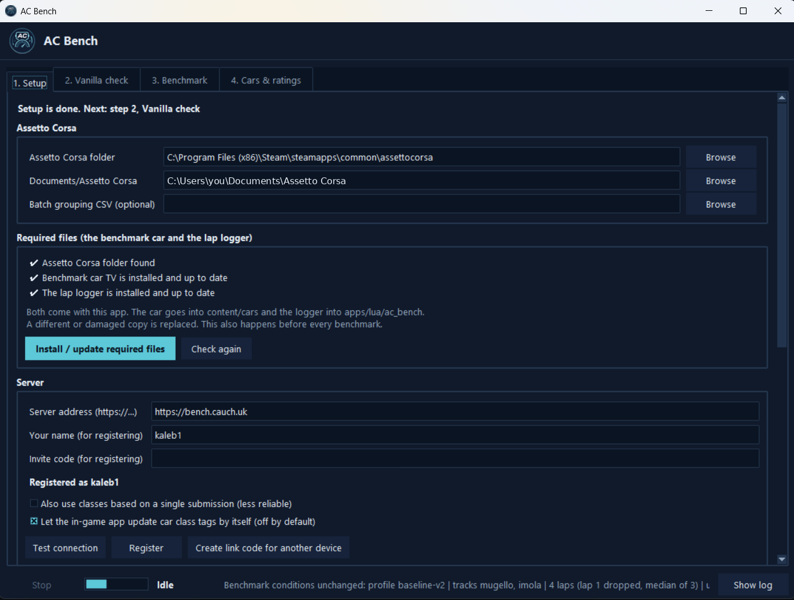
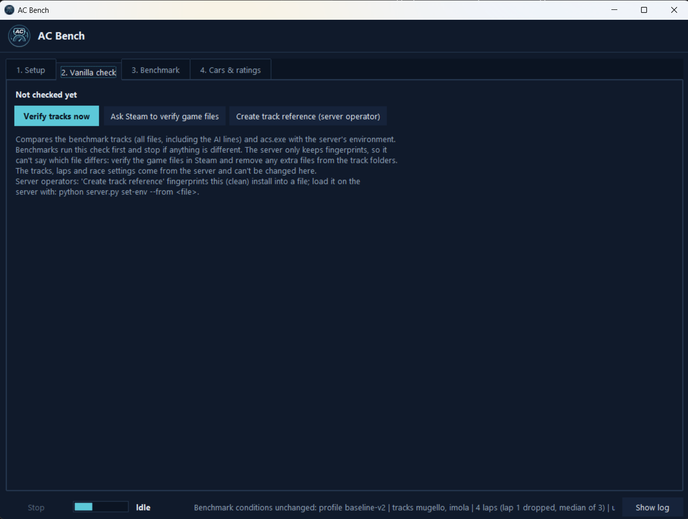
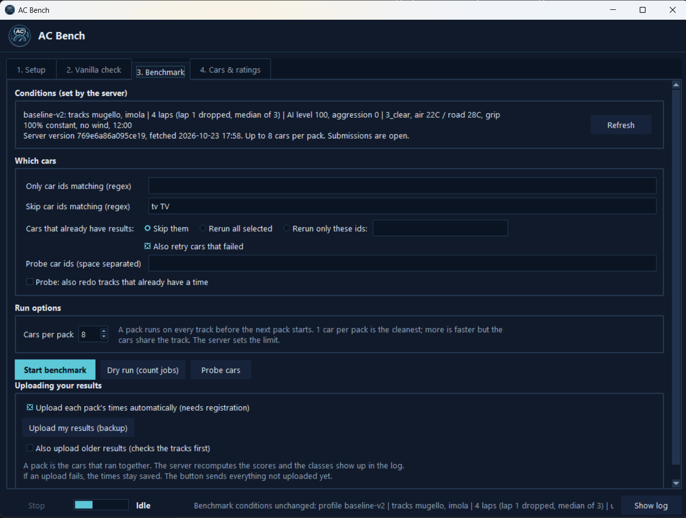
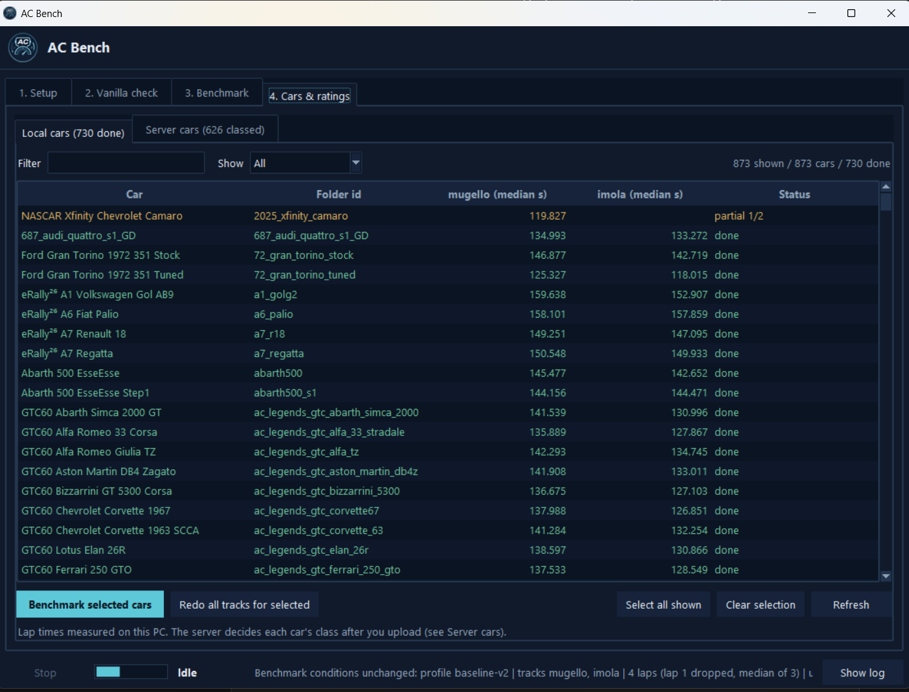
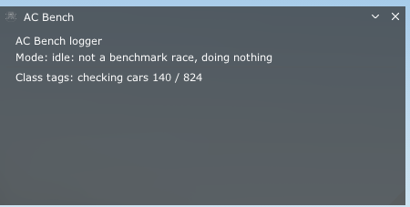
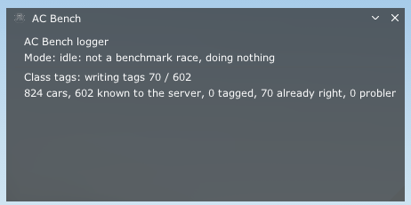

<p align="center">
  
</p>

<h1 align="center">AC Bench Desktop</h1>

<p align="center">
  Benchmark your Assetto Corsa cars and compare them against everyone else.
</p>

---

AC Bench measures how fast AI drivers lap each of your installed cars under fixed conditions, uploads the times to an
[AC Bench server](https://github.com/yiyirob973/AC-Bench-Server), and returns a performance class for every car. Those
classes can then be written into your car list as tags so you can build balanced grids from a large mod collection.

This project includes the Windows desktop app, the benchmark runner, and a small in-game app for Assetto Corsa.

## What this does

- Benchmarks each car under the same conditions selected by the server
- Compares your results against other players using the same fixed rules
- Assigns a class to each car from the server's published ratings
- Writes those classes into `ui_car.json` as tags for easy filtering in Content Manager
- Supports a public server or a private/self-hosted server

## Public server

A public server is available at: https://bench.cauch.uk

Enter this as the server address on the Setup tab. If you prefer, you can also run your own server using the
[AC Bench Server project](https://github.com/yiyirob973/AC-Bench-Server).

## Requirements

- Windows
- Assetto Corsa (Steam)
- [Custom Shaders Patch](https://acstuff.club/patch/) installed
- A valid server address and invite code for registration
- Python 3, only if running from source

## Quick start

1. Download `AC-Bench.exe` from the [Releases page](../../releases).
2. Run it without installation.
3. On the Setup tab, enter your server address and registration details.
4. Complete the required setup steps in order:
   - Setup
   - Vanilla check
   - Benchmark
   - Cars & ratings
5. Run your benchmark and upload results.

If you want to run from source instead, use `run_gui.bat` or run:

```bat
python ac_bench_gui.py
```

## How it works

Each car is benchmarked under the same rules and conditions chosen by the server. The server decides the tracks, lap
count, AI settings, weather, and other benchmark parameters. The app fetches those conditions from the server and does
not modify them locally.

A car's score on a given track is based on the median of the timed laps, with the first lap discarded because it is a
standing start. Because the conditions are fixed by the server, times from different cars and different PCs can be
compared directly.

The desktop app only measures lap times. The server then recomputes the scores from the uploaded data and decides the
class for each car.

## The tabs

The status bar along the bottom is always visible and includes:

- Stop
- Progress indicator
- Current state
- Server conditions
- Show log

### 1. Setup

<p align="center">
  
</p>

Use this tab to configure:

- Assetto Corsa game folder and Documents/Assetto Corsa folder
- Required files to install/update for the benchmark and in-game app
- Server address, your name, invite code, and registration
- In-game tag syncing options

### 2. Vanilla check

<p align="center">
  
</p>

The vanilla check compares the benchmark tracks and `acs.exe` against the server's reference environment. Benchmarks run
this check first and stop if anything differs, so everyone is measuring from the same clean setup.

The server stores only fingerprints, not the original file list. If the check fails, verify your Steam install and
remove any extra files from the track folders.

### 3. Benchmark

<p align="center">
  
</p>

The benchmark tab allows you to:

- View the current server conditions
- Filter which cars to test
- Choose what to do with cars that already have results
- Set pack size
- Start a benchmark, do a dry run, or probe specific cars

By default, a pack uploads its times as soon as it is complete. If an upload fails due to being offline, rate-limited,
not registered, or another temporary problem, the benchmark continues and save files remain available for a later retry.

### 4. Cars & ratings

<p align="center">
  
</p>

This tab shows:

- Local cars with lap-time results and status
- Server cars with the current class assignment for installed cars
- Options to rerun selected cars
- Ways to apply server classes as tags
- The ability to benchmark installed cars that do not yet have a server class

## Car classes and tags

Classes are named like `1A` (top class), `1B` through `1Z`, then `2A` through `2Z`, `3A`, and so on. Tags are written
as `#Pride-1A` and can be searched in Content Manager.

Applying tags replaces the previous `#Pride-` tag for a car while leaving other tags untouched. Each car's
`ui_car.json` file is backed up before it is changed.

### Applying tags

On the Cars & ratings tab, **Apply server classes as tags** finds installed cars, asks the server for their classes,
and writes the class tag into each verified car. Provisional classes can be included if enabled in Settings. The bundled
benchmark car is skipped.

### Tags from inside the game

The in-game app can also update tags while you play, so class tags stay current without opening the desktop app. This
feature is disabled by default and can be turned on from the Setup tab.

- It only runs during offline races and never during online or benchmark races.
- It starts as soon as a race has loaded and writes any new class tags.
- A class change on the server is picked up the next time you start a race.
- The desktop app does not need to be running.
- If the Custom Shaders Patch version does not provide `ac.checksumSHA256`, the in-game app reports that it is unavailable.

## The in-game app

The in-game app shows up in Assetto Corsa's app bar as **AC Bench**. During a benchmark race it logs the AI lap times
for the desktop app. Outside of benchmark races it mostly stays idle, aside from the tag-sync feature if enabled.

<p align="center">
  
  &nbsp;
  
</p>

## Starting races

Every race is started with Assetto Corsa's own **Start race** hotkey (the one in Content Manager > Settings > Assetto
Corsa > Controls > System > Race). A key already assigned is always used and never changed. If no hotkey is assigned,
the app assigns one. It never clicks buttons or manipulates the UI automatically.

Custom Shaders Patch handles the hotkey in-game, so Content Manager does not need to be running.

## Uploading results

By default, each benchmark pack uploads its times as soon as all cars in that pack have run on every track. The server
recomputes the scores and returns each car's class, which is displayed in the log and in the Cars & ratings tab.

If an upload fails (for example because you are offline or not registered), the benchmark continues and the data is saved
locally. The backup upload button on the Benchmark tab sends anything that has not been uploaded yet. Uploaded results are
remembered so nothing is sent twice.

## Rebenchmarking

**Benchmark selected cars** reruns the cars you selected on tracks where they do not yet have a valid time. **Redo all
tracks for selected** reruns those cars on every track.

## Same account on another device

On the device that is already registered, create a link code on the Setup tab. On the new device, choose the option to
use the same account, enter the code, and sign in. The code works once and expires after a few minutes. Each device gets
its own key for the same account.

## Running a server

Results are sent to an [AC Bench Server](https://github.com/yiyirob973/AC-Bench-Server), which validates them, combines
results from multiple users, and publishes versioned class tables. That repository includes setup instructions, including
how to create and load the track reference used by the vanilla check.

The Vanilla check tab includes a button to create that reference from a clean install.

## Building the executable

The GitHub workflow in `.github/workflows/build.yml` builds `AC-Bench.exe` with [Nuitka](https://nuitka.net/), which
compiles the Python code into a native Windows program.

The executable bundles the app resources it needs, including the benchmark car and Lua app. Settings, results, and logs
are stored next to the executable, or in `%LOCALAPPDATA%\AC-Bench` if the install folder is not writable.

**Antivirus warnings:** a brand-new, unsigned program is sometimes flagged by antivirus software before it develops a
reputation. Building with Nuitka reduces the chance of this, but it cannot eliminate it completely. If you prefer not
to run the executable, you can run the project from source instead.

## Repository layout

```text
AC-Bench-Desktop/
  README.md
  run_gui.bat                  start the GUI from source on Windows
  ac_bench_gui.py              the GUI
  ac_lap_bench.py              builds and runs the benchmark races
  ac_baseline.py               the fixed baseline
  ac_conditions.py             benchmark conditions from the server
  ac_carid.py                  identifies cars by physics hash
  ac_car_classifier.py         reads car data
  ac_rating.py                 scores results
  ac_track_check.py            vanilla check of the tracks and acs.exe
  ac_cloud.py                  server API: register, upload, link devices
  ac_live.py                   live car lookups and tag writing
  ac_tag_writer.py             writes the class tags
  ac_input.py, ac_controls.py  the race start hotkey
  ac_paths.py                  where files live
  ac_theme.py                  window icon and logo
  branding/
    ac-bench.ico               exe and window icon
    ac-bench.png               logo
    header.png                 small logo for the window header
  docs/screenshots/            screenshots used in this README
  bundled_car/                 the TV car every race drives
  apps/lua/ac_bench/           the in-game app
    ac_bench.lua               lap logger
    class_sync.lua             in-game class tagging
    manifest.ini
    icon.png                   app bar icon
```

## Credits

The bundled TV car is by EmilioGQ: <https://www.overtake.gg/downloads/tv-car.45108/>. Every run drives it so results
stay consistent between installs. It is never benchmarked itself and is never listed or tagged.

## Disclaimer

This project is provided as-is for Assetto Corsa benchmarking and class-tagging workflows. It is not affiliated with,
authorized by, or endorsed by Kunos, Steam, or any official Assetto Corsa service.

Use it at your own risk, and always back up any configuration or car data before applying class tags.
